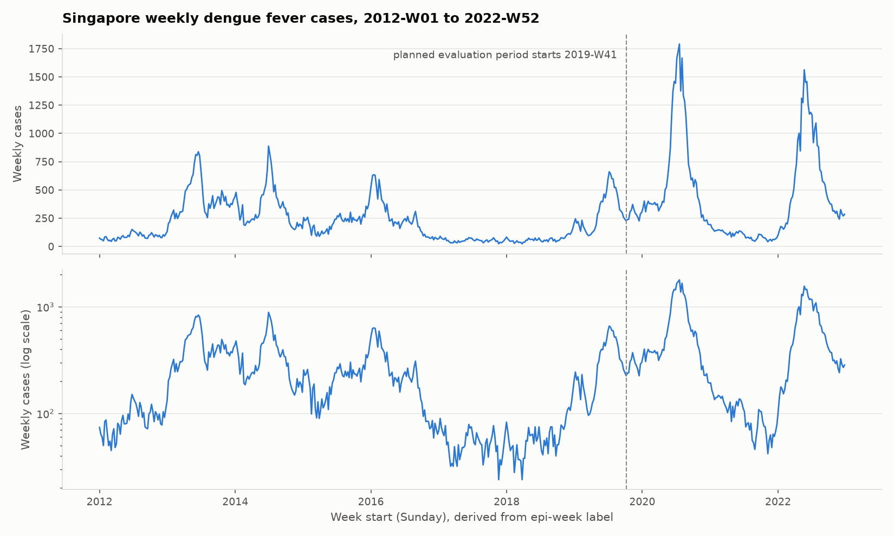
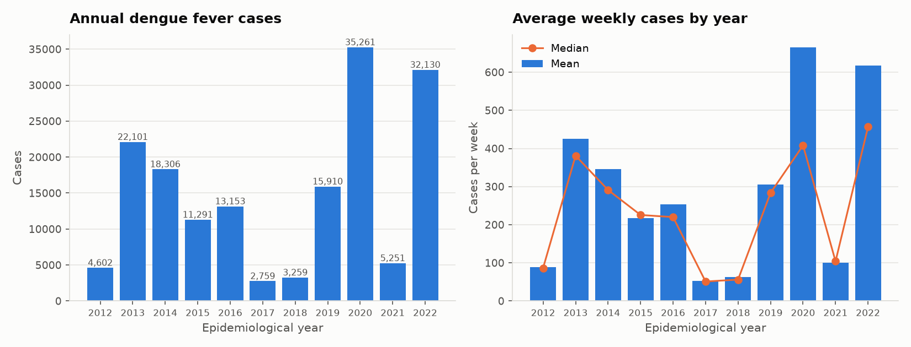
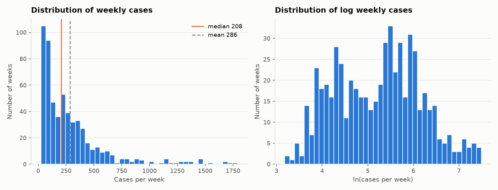
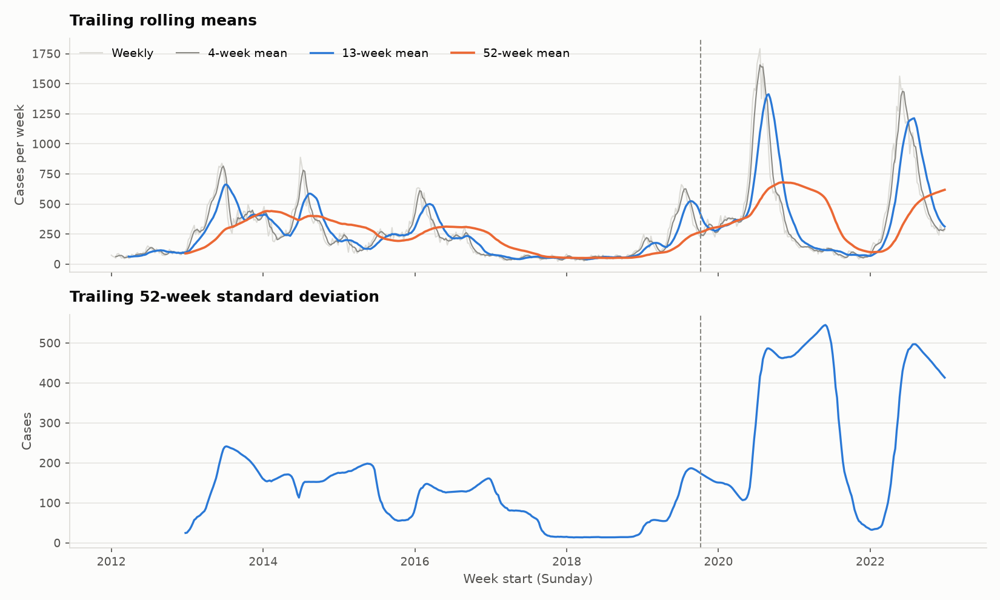
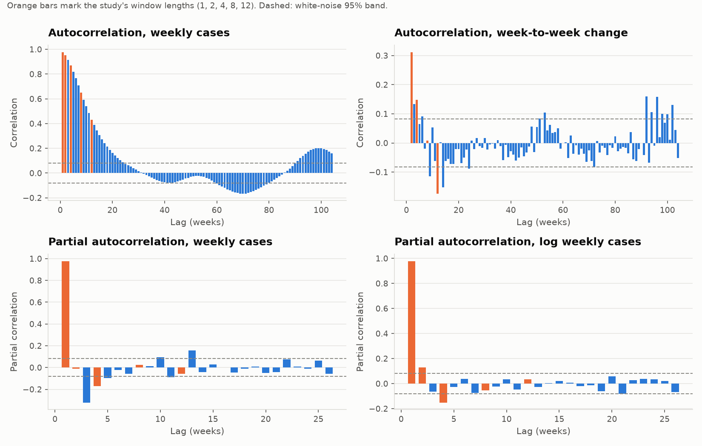
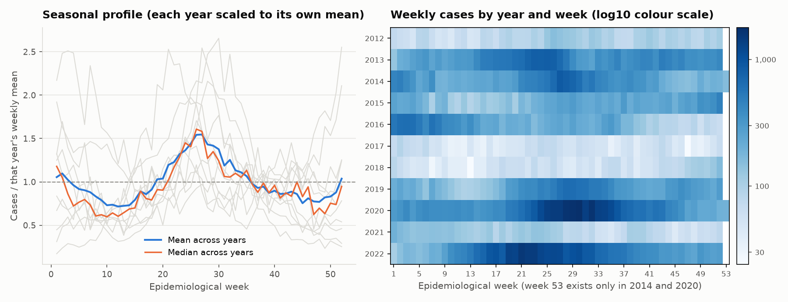
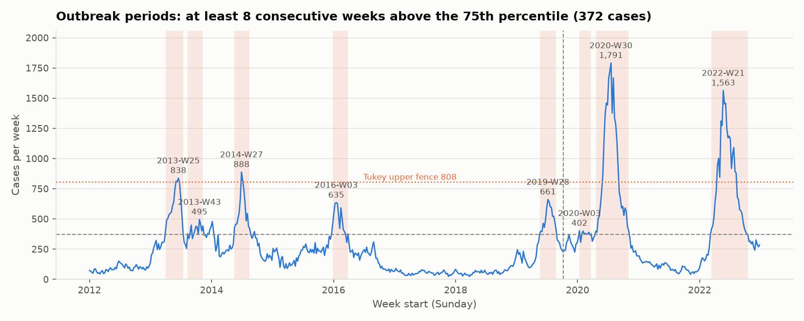
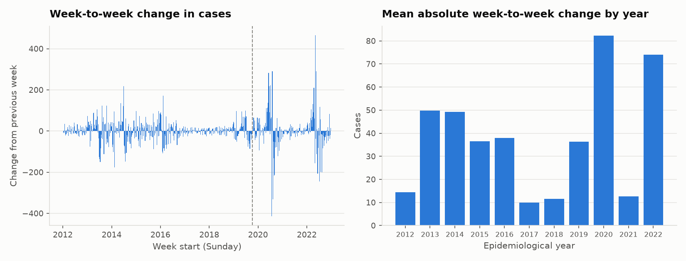
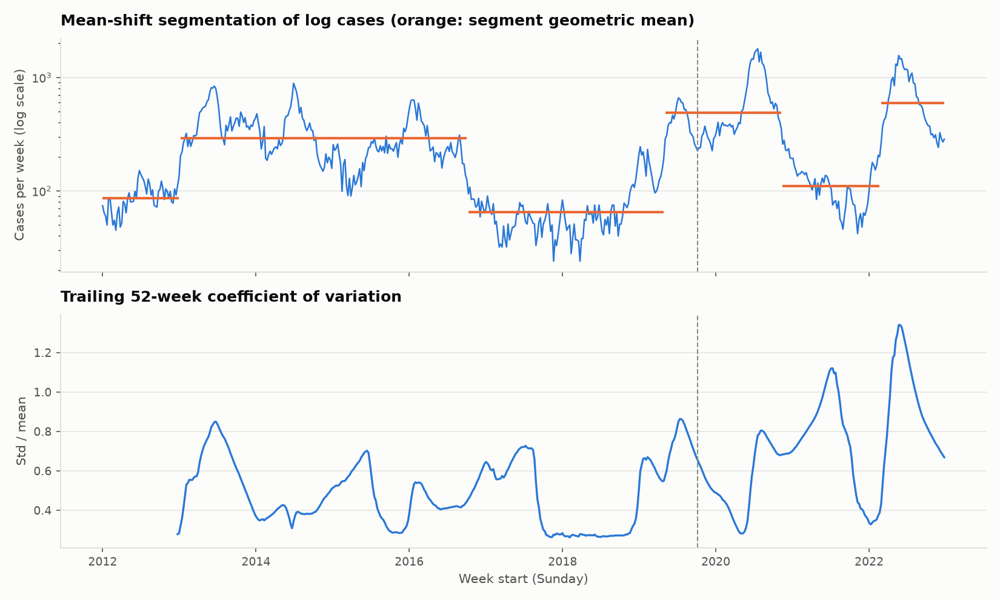

# Singapore dengue fever series — exploratory data analysis (Phase 4)

**Run:** 2026-11-17 · **Script:** `singapore_analysis/singapore_eda.py` ·
**Figures:** `singapore_analysis/figures/` · **Tables:** `singapore_analysis/tables/`

Descriptive only. No model was trained. Sections marked *Interpretation* are
readings of the numbers, not established facts.

## 1. Main findings

1. **The series is a sequence of multi-year regimes, not a repeating annual cycle.**
   Which year a week falls in explains 49% of the variance in weekly cases; which
   week of the year it falls in explains 12%. Annual totals range from 2,759
   (2017) to 35,261 (2020), a factor of 12.8.
2. **Two epidemics dominate.** 2020 and 2022 together hold 41% of all cases in
   11 years. Their peaks (1,791 and 1,563 cases a week) are about twice the
   highest value in the preceding eight years (888).
3. **Both of those epidemics fall inside the planned evaluation period.** Under
   the original study's 70% rule, evaluation starts at 2019-W41. That final 29%
   of weeks holds 46% of all cases, and 28 of its 169 weeks exceed anything seen
   before it.
4. **Week-to-week persistence is very strong.** Lag-1 autocorrelation is 0.976.
   Partial autocorrelation is clearly non-zero at lags 3 and 4 and close to zero
   from lag 5 onward, with one exception at lag 13.
5. **Noise scales with the level.** The mean absolute weekly change is 10 cases
   in 2017 and 82 in 2020, but as a percentage of the level it stays between 12%
   and 20% in every year.

The consequence for the experiment is set out in section 12.

## 2. Full time series

574 weeks, 164,023 cases. On the linear scale the series is dominated by 2020
and 2022. The log scale shows the structure of the quiet periods: 2012, mid-2016
to early 2019 and 2021 sit at 30–150 cases a week, and the busy periods at
300–1,800. The dashed line marks 2019-W41, where the planned evaluation period
begins.

## 3. Annual totals and weekly averages

| Year | Weeks | Total cases | Weekly mean | Weekly median | Weekly max | Peak week | Share of all cases |
|---|---|---|---|---|---|---|---|
| 2012 | 52 | 4,602 | 88.5 | 86.5 | 151 | W26 | 2.8% |
| 2013 | 52 | 22,101 | 425.0 | 381.0 | 838 | W25 | 13.5% |
| 2014 | 53 | 18,306 | 345.4 | 291.0 | 888 | W27 | 11.2% |
| 2015 | 52 | 11,291 | 217.1 | 225.5 | 458 | W52 | 6.9% |
| 2016 | 52 | 13,153 | 252.9 | 220.0 | 635 | W03 | 8.0% |
| 2017 | 52 | 2,759 | 53.1 | 51.0 | 90 | W02 | 1.7% |
| 2018 | 52 | 3,259 | 62.7 | 56.0 | 160 | W52 | 2.0% |
| 2019 | 52 | 15,910 | 306.0 | 283.5 | 661 | W28 | 9.7% |
| 2020 | 53 | 35,261 | 665.3 | 408.0 | 1,791 | W30 | 21.5% |
| 2021 | 52 | 5,251 | 101.0 | 104.0 | 194 | W01 | 3.2% |
| 2022 | 52 | 32,130 | 617.9 | 456.5 | 1,563 | W21 | 19.6% |

Source: `tables/eda_annual_summary.csv`.

- Years fall into two groups with little in between: four low years (2012, 2017,
  2018, 2021; 2,759–5,251 cases) and seven high years (11,291–35,261).
- In 2020 and 2022 the mean is far above the median (665 vs 408; 618 vs 457),
  which reflects a short, very high peak on top of an already elevated year.
- 2014 and 2020 have 53 weeks. The extra week adds 158 and 193 cases, under 1%
  of either year's total, so annual totals remain comparable.

*Interpretation.* There is no monotonic trend. Low and high periods alternate
on a scale of one to four years. Shifts in the dominant dengue serotype are the
usual explanation offered for this pattern in Singapore; that was not verified
here and the file contains no serotype information.

## 4. Distribution and descriptive statistics

| Statistic | Value | Statistic | Value |
|---|---|---|---|
| Observations | 574 | Mean | 285.8 |
| Minimum | 24 | Standard deviation | 295.6 |
| 5th percentile | 44.7 | Coefficient of variation | 1.03 |
| 25th percentile | 81 | Skewness | 2.35 |
| Median | 208 | Excess kurtosis | 6.55 |
| 75th percentile | 372 | Variance-to-mean ratio | 305.7 |
| 95th percentile | 882.2 | Skewness of log cases | 0.10 |
| 99th percentile | 1,459.3 | Excess kurtosis of log cases | −0.74 |
| Maximum | 1,791 | Share of cases in the top 10% of weeks | 34.8% |

Source: `tables/eda_descriptive_statistics.csv`.

- Strongly right-skewed. The mean is 37% above the median.
- The variance is about 306 times the mean, far from Poisson counting noise. The
  variation is epidemic dynamics, not sampling error.
- On the log scale the distribution is close to symmetric (skewness 0.10) and
  visibly two-humped, matching the low-year and high-year groups in section 3.
- There are no zeros and nothing below 24.

*Interpretation.* A log transform would make this series far better behaved.
The original study uses raw counts and lists that as a limitation (limitation 6).
The protocol keeps raw counts so the method is unchanged. The practical effect is
that MAE and RMSE in cases will be dominated by the few folds that contain an
epidemic peak, as they were for San Juan.

## 5. Rolling averages

All rolling statistics are trailing (they use past weeks only).
Source: `tables/eda_rolling_statistics.csv`.

- The 52-week mean moves between about 50 and 680. It never settles at a
  stable level, which is the regime structure of section 3 seen continuously.
- The 13-week mean tracks each epidemic closely; the 4-week mean is almost
  indistinguishable from the weekly series outside the peaks.
- The 52-week standard deviation rises and falls with the mean. Its two highest
  stretches are the 2020 and 2022 epidemics.

## 6. Autocorrelation

| Lag (weeks) | 1 | 2 | 3 | 4 | 8 | 12 | 13 | 26 | 52 |
|---|---|---|---|---|---|---|---|---|---|
| Autocorrelation, cases | 0.976 | 0.953 | 0.915 | 0.870 | 0.649 | 0.432 | 0.388 | 0.063 | −0.024 |
| Partial autocorrelation, cases | 0.976 | −0.013 | −0.322 | −0.171 | 0.025 | −0.057 | 0.158 | — | — |
| Partial autocorrelation, log cases | 0.977 | 0.128 | −0.064 | −0.151 | −0.054 | 0.034 | −0.026 | — | — |
| Autocorrelation, weekly change | 0.000 | 0.311 | 0.133 | 0.147 | 0.008 | −0.174 | 0.002 | −0.022 | −0.001 |

The approximate 95% band for white noise is ±0.082. Source: `tables/eda_autocorrelation.csv`.

- **Lag 1 carries almost everything.** 0.976 at one week, still 0.87 at four
  weeks, 0.43 at twelve, and indistinguishable from zero by 26.
- **There is no annual autocorrelation.** The value at lag 52 is −0.02. A series
  with a stable yearly cycle would show a clear positive value there.
- **Partial autocorrelation points to about four weeks of usable linear memory.**
  After lag 1, the values at lags 3 (−0.32) and 4 (−0.17) are well outside the
  band and lag 5 (−0.10) is just outside it. From lag 6 to lag 12 everything is
  within or at the edge of the band. Lag 13 (0.16) is an isolated exception.
- **Weekly changes have zero lag-1 autocorrelation but positive values at lags 2 to 4**
  (0.31, 0.13, 0.15).

*Interpretation.* The pattern in the weekly changes is what a smooth epidemic
curve plus week-level reporting noise would produce. A smooth curve alone gives
changes that are positively correlated at lag 1. Noise that is independent from
week to week gives changes that are negatively correlated at lag 1. Here the two
cancel at lag 1 and the smooth component shows through at lags 2–4. If that
reading is right, a model with two to four lags can average out some reporting
noise that persistence, which uses one week, cannot. This is a reason to expect
that windows beyond 1 *could* help in Singapore more than in San Juan. It is a
hypothesis from descriptive statistics, the relationships are linear ones only,
and it says nothing about whether tree models at fixed settings will realise it.

The log-scale partial autocorrelation is different in detail (lag 2 positive,
lag 3 inside the band), so the specific lags are sensitive to scale. The broad
statement, that little is left after about four weeks, holds on both scales.

## 7. Seasonality

| Measure | Value |
|---|---|
| Variance in cases explained by week of year | 12.1% |
| Variance in cases explained by year | 48.6% |
| Variance in log cases explained by week of year | 6.0% |
| Variance in log cases explained by year | 74.2% |
| Variance in log cases explained by week of year, after removing each year's mean | 23.2% |
| Peak of the average seasonal profile | Week 27 (early July) |
| Trough of the average seasonal profile | Week 12 (late March) |
| Peak-to-trough ratio of the average profile | 2.16 |
| Share of cases in weeks 14–39 (April to September) | 63.7% |
| Years whose highest week falls in weeks 23–35 | 5 of 11 |

Week 53 is excluded from the week-of-year statistics because it exists in only
two years. Sources: `tables/eda_seasonality_statistics.csv`,
`tables/eda_seasonal_profile_by_week.csv`.

- There is an average mid-year rise: weeks 19–35 run above each year's own mean,
  and weeks 7–17 and 39–51 run more than 10% below it.
- It is weak and unreliable. The grey lines (individual years) scatter widely
  around the average profile. Only five years peak in mid-year (2012, 2013,
  2014, 2019, 2020); 2022 peaks earlier, in week 21.
- Five years have their highest week at a year boundary (2015-W52, 2016-W03,
  2017-W02, 2018-W52, 2021-W01). Two of these are one epidemic that ran from
  late 2015 into early 2016. The others are low years, where the "peak" is the
  tail of a previous epidemic or the start of the next.
- The heatmap shows the same thing: dark and light *rows* (years) are far more
  distinct than any dark *column* (season).

*Interpretation.* Seasonality exists but is secondary to the between-year
regime. Singapore is equatorial, with far less seasonal contrast in climate than
San Juan. None of the study's windows (at most 12 weeks) could capture an annual
cycle in any case, so weak seasonality neither helps nor hurts the window
comparison directly. It does mean that folds of 13 or 26 weeks will differ mainly
by which regime they fall in, not by season.

## 8. Major outbreak periods

**Definition used (descriptive, set before looking at which weeks it selects):**
a run of at least 8 consecutive weeks above the series' 75th percentile
(372 cases), with runs separated by 2 weeks or fewer merged. This is not an
official MOH epidemic threshold.

| Period | Weeks | Peak week | Peak cases | Total cases | Share of all cases | In evaluation period |
|---|---|---|---|---|---|---|
| 2013-W14 to 2013-W29 | 16 | 2013-W25 | 838 | 9,890 | 6.0% | No |
| 2013-W33 to 2013-W46 | 14 | 2013-W43 | 495 | 5,696 | 3.5% | No |
| 2014-W21 to 2014-W34 | 14 | 2014-W27 | 888 | 8,036 | 4.9% | No |
| 2015-W52 to 2016-W13 | 14 | 2016-W03 | 635 | 6,810 | 4.2% | No |
| 2019-W21 to 2019-W35 | 15 | 2019-W28 | 661 | 7,581 | 4.6% | No |
| 2020-W03 to 2020-W13 | 11 | 2020-W03 | 402 | 4,118 | 2.5% | Yes |
| 2020-W17 to 2020-W45 | 29 | 2020-W30 | 1,791 | 27,512 | 16.8% | Yes |
| 2022-W11 to 2022-W42 | 32 | 2022-W21 | 1,563 | 27,259 | 16.6% | Yes |

Source: `tables/eda_outbreak_periods.csv`. Two shorter runs above the threshold
(2013-W50 to 2014-W03, 6 weeks; 2014-W38, 1 week) did not meet the 8-week minimum.

- The 2020 and 2022 epidemics are in a class of their own: twice as long, about
  twice as high, and three to four times the total of any earlier outbreak.
- 2013 is one prolonged elevated year with two waves.
- 2020-W03 to W13 is a plateau just above the threshold (mean 374) that precedes
  the main 2020 epidemic; it is the lead-in, not a separate event.
- The 2015–16 outbreak is the only one centred on the turn of the year.
- Rises are generally faster than declines in the two largest epidemics
  (2020: 13 weeks up, 15 down; 2022: 10 up, 21 down).

## 9. Extreme observations

**Levels.** 35 weeks exceed Tukey's upper fence (Q3 + 1.5 × IQR = 808.5):

| Year | Weeks above the fence | Range of those weeks |
|---|---|---|
| 2013 | 2 | 813–838 |
| 2014 | 2 | 818–888 |
| 2020 | 14 | 868–1,791 |
| 2022 | 17 | 845–1,563 |

All of the 15 highest weeks are in 2020 (10) or 2022 (5). These are sustained
epidemic peaks, each surrounded by similar neighbouring values. None is an
isolated spike of the kind a data-entry error would produce, and all 574 values
match the MOH source. **No observation is treated as an outlier to be removed or
adjusted.**

**Changes.** Sources: `tables/eda_largest_weekly_changes.csv`,
`tables/eda_weekly_change_by_year.csv`.

| Measure, whole series | Value |
|---|---|
| Mean absolute week-to-week change | 37.8 cases |
| Median absolute week-to-week change | 20 cases |
| Root-mean-square week-to-week change | 63.6 cases |
| Mean absolute percentage change | 15.7% |
| Standard deviation of log change | 0.195 |
| Share of weeks that rise | 49.4% |

The mean absolute change is, by construction, the error a "next week equals this
week" rule would make over the whole series. It is reported here as a property
of the data. It is not an experimental result: the experiment scores persistence
on specific folds.

- The largest absolute moves are all at the two big peaks: +466 (2022-W19),
  −415 (2020-W31), −331 (2020-W33), +291 (2020-W32), +290 (2022-W21).
- The 2020 peak is a sawtooth: 1,791 → 1,376 → 1,667 → 1,336 across weeks 30–33.
  The 2022 rise has a similar notch: 1,002 → 845 → 1,311 across weeks 17–19.
- The largest *relative* moves are in low-count periods and several follow a
  dip-and-rebound shape: 2015-W06 to W08 (173 → 99 → 172), 2018-W06 to W08
  (50 → 28 → 38), 2019-W05 to W07 (179 → 135 → 232).
- By year, the mean absolute change ranges from 10 cases (2017) to 82 (2020).
  The mean absolute *percentage* change ranges only from 11.5% to 20.4% and is
  highest in the low-count years.

*Interpretation.* Several dips line up with weeks containing public holidays:
Chinese New Year in February 2015, 2018 and 2019, and holiday weeks around the
2020 and 2022 peaks. A notification-dated series would show exactly this, with
fewer clinic visits and tests in a holiday week and a catch-up the week after.
This was **not verified** against a holiday calendar week by week and the dating
basis of the series is not established (see the comparability document). If it
is right, part of the week-to-week noise is a reporting artefact, which fits the
autocorrelation pattern in section 6. One large fall, 2014-W08 (369 → 193), does
not coincide with an obvious holiday and is unexplained.

For comparison, San Juan's mean absolute weekly change is 8.0 cases on a mean of
34.2 (23% of the mean); Singapore's is 37.8 on a mean of 285.8 (13%). Relative to
its level, Singapore is the smoother series.

## 10. Structural breaks

**Method.** Greedy mean-shift segmentation of log cases (binary segmentation,
minimum segment 26 weeks, 5 breaks requested). This procedure always returns the
number of breaks asked for, so it describes where level shifts are largest. It
is not a test and gives no evidence on its own that a "break" is real.

| Segment | Weeks | Mean cases | Geometric mean | Standard deviation |
|---|---|---|---|---|
| 2012-W01 to 2013-W01 | 53 | 89.3 | 85.8 | 25.2 |
| 2013-W02 to 2016-W40 | 196 | 325.3 | 290.0 | 164.2 |
| 2016-W41 to 2019-W18 | 134 | 73.8 | 64.9 | 43.7 |
| 2019-W19 to 2020-W46 | 80 | 583.0 | 490.7 | 401.8 |
| 2020-W47 to 2022-W08 | 67 | 122.3 | 110.7 | 54.9 |
| 2022-W09 to 2022-W52 | 44 | 700.1 | 595.0 | 396.8 |

Sources: `tables/eda_structural_break_segments.csv`, `tables/eda_structural_break_candidates.csv`.

The series alternates between a low state (geometric mean roughly 65–110 cases a
week) and a high state (290–595), with each high state higher than the last.

**The break that matters for the experiment** is the one at the boundary between
training and evaluation (`tables/eda_regime_comparison.csv`):

| | Before evaluation (2012-W01 to 2019-W40) | Evaluation period (2019-W41 to 2022-W52) |
|---|---|---|
| Weeks | 405 | 169 |
| Mean cases | 217.3 | 449.9 |
| Median cases | 173 | 307 |
| Standard deviation | 178.5 | 427.7 |
| Maximum | 888 | 1,791 |
| 90th percentile | 470 | 1,174 |
| Mean absolute weekly change | 30.8 | 54.7 |
| Standard deviation of log change | 0.21 | 0.16 |
| Lag-1 autocorrelation | 0.97 | 0.97 |
| Weeks above the earlier period's maximum | — | 28 |

- The level, spread and extremes roughly double. The *relative* behaviour does
  not change: lag-1 autocorrelation is the same and week-to-week change on the
  log scale is, if anything, smaller.
- The evaluation period also contains the COVID-19 years. 2020 brought the
  largest epidemic on record during the period of movement restrictions, and
  2021 was a low year. Whether the pandemic changed transmission, health-seeking
  or reporting cannot be determined from this series.

*Interpretation.* On the raw-count scale the evaluation period is a different
regime from the training period. On the log scale the dynamics look continuous.
Because the study uses raw counts, the regime shift will be visible in the
results.

## 11. What this EDA does not establish

- Whether any of the regime shifts is caused by serotype change, vector control,
  the pandemic or reporting changes.
- Whether the holiday-week dips are reporting artefacts.
- Anything about non-linear dependence. Autocorrelation and partial
  autocorrelation measure linear relationships only.
- Any forecast accuracy. No model was run.

## 12. Implications for the experiment

| # | Finding | Implication |
|---|---|---|
| 1 | Lag 1 dominates; partial autocorrelation is small beyond lag 4 or 5 | The data give no descriptive reason to expect 8 or 12 weeks to help. Whether 2–4 weeks beat 1 is the open question |
| 2 | Weekly changes are uncorrelated at lag 1 but positively correlated at lags 2–4 | Unlike the picture from San Juan, there may be something for a short multi-week window to exploit. Persistence may be beatable here; this is a hypothesis |
| 3 | The evaluation period contains values up to twice the training maximum | Tree models cannot predict above the largest target they were trained on. In the fold covering the 2020 rise, the models will be capped near 888 while persistence is not. That affects every window roughly equally, so it bears mainly on the comparison with persistence and less on the comparison between windows |
| 4 | The evaluation period is not representative of the series | Results describe forecasting through two record epidemics and a pandemic. They should not be presented as typical Singapore performance |
| 5 | Noise scales with the level; a few peak weeks hold most of the absolute error | Fold-level MAE will vary by an order of magnitude between quiet and epidemic folds. Paired, within-fold comparisons are essential; unpaired comparisons of means will be uninformative |
| 6 | No stable seasonality; regimes last one to four years | Fold differences will reflect regime, not season. The seasonal-phase concern raised for 13-week folds in the original (limitation 12) is less relevant here |
| 7 | Week 53 values are ordinary; all weeks are 7 days | No special handling is needed in feature construction |
| 8 | No data errors, no missing weeks | No cleaning step is added to the pipeline |
